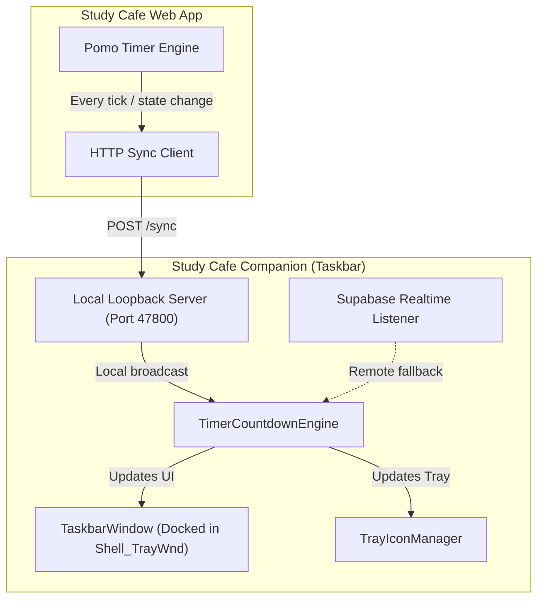

<p align="center">
  
</p>

<h1 align="center">Study Cafe Companion</h1>

<p align="center">
  <strong>Native Windows 11 taskbar companion widget for Study Cafe — live synchronized Pomodoro timer docked seamlessly next to your system tray.</strong>
</p>

<p align="center">
  
  
  
  <a href="LICENSE"></a>
</p>

<p align="center">
  <a href="#-features">Features</a> •
  <a href="#-installation">Installation</a> •
  <a href="#-controls--shortcuts">Controls & Shortcuts</a> •
  <a href="#-architecture--sync">Architecture & Sync</a> •
  <a href="#-building-from-source">Building</a> •
  <a href="#-attribution">Attribution</a>
</p>

<br/>

## 🌟 Features

* 🪟 **Native Taskbar Integration**: Docks directly as a native `WS_CHILD` window inside `Shell_TrayWnd`. Sits cleanly on the right of the taskbar, immediately to the left of the system tray chevron (`^`), looking and feeling like an official Windows 11 widget.
* 🎨 **Pixel-Perfect Windows 11 Fluent Theming**:
  * **Adaptive Theme Switching**: Automatically tracks Windows Dark Mode and Light Mode in real-time.
  * **Translucent "Milky" Hover Outline**: Windows 11 taskbar button pill shape (`36 DIP` height, `4px` corner radius) with subtle translucent background (`#12ffffff` Dark / `#70ffffff` Light) and crisp 1px outline (`#22ffffff` Dark / `#14000000` Light).
  * **Smooth 80ms Motion**: Transitions in and out using hardware-accelerated Fluent animation curves.
  * **Full Taskbar Hitbox**: Solid hit testing across the entire taskbar height with zero dead zones.
* 💬 **Native Floating Tooltip Card**:
  * Features the exact Windows 11 Fluent tooltip design matching the system tray's *"Show hidden icons"* card.
  * Mathematically centered directly above the widget pill, floating 10 DIP above the taskbar with soft drop shadow and rounded corners.
* ⏱️ **Drift-Free Live Countdown**:
  * Accurate to the millisecond, rendering crisp tabular numbers in `Segoe UI Variable`.
  * Distinct phase indicators: **Focus** (terracotta `#E06D53`), **Break** (sage green `#5EAA8D`), and **Ready** (neutral gray).
* 🔄 **Zero-Config Real-Time Sync**:
  * **Local HTTP Loopback (`127.0.0.1:47800`)**: Browser tabs in Study Cafe instantly sync timer state to the companion without any setup.
  * **Supabase Realtime**: Connects as a listener-only peer to room broadcasts for remote synchronization.
* 🚀 **Zero-Overhead & High Performance**:
  * Event-driven UIA (`TaskbarLayoutProbe`) and WinEvent hooks (`EVENT_OBJECT_LOCATIONCHANGE`).
  * Never wastes CPU cycles polling in the background.
* 🔔 **System Tray Integration**:
  * Dedicated notification tray icon that adapts its color dynamically to the study phase.
  * Right-click menu for instant status preview, toggling *"Start with Windows"*, or exiting.

---

## 📦 Installation

Choose the installation method that fits your workflow:

### Option 1: Setup Installer (Recommended)

The Inno Setup installer delivers a user-friendly, zero-friction experience:

1. Download **`StudyCafeCompanion-Setup-x64.exe`** from [GitHub Releases](https://github.com/ahmadtsu/study-cafe-companion/releases/latest).
2. Run the installer:
   * **Automatic Prerequisites**: Detects whether the **.NET Desktop Runtime 9.0** is installed. If missing, it downloads and installs it automatically.
   * **No Administrator Rights Required**: Installs per-user by default (`%LOCALAPPDATA%\Programs\Study Cafe Companion`) without UAC prompts.
   * **Clean Process Handling**: Automatically terminates and restarts running instances without file locking errors.
   * Creates Windows Start Menu and optional Desktop shortcuts.

### Option 2: Portable Executable

For users who prefer a standalone setup:

1. Ensure [.NET Desktop Runtime 9.0](https://dotnet.microsoft.com/en-us/download/dotnet/9.0) (or later) is installed.
2. Download **`StudyCafe.Companion.exe`** from [GitHub Releases](https://github.com/ahmadtsu/study-cafe-companion/releases/latest).
3. Place `StudyCafe.Companion.exe` in any folder of your choice and launch it.
4. Right-click the widget or tray icon to toggle **"Start with Windows"** at any time.

---

## ⌨️ Controls & Shortcuts

| Action | Control | Description |
| :--- | :--- | :--- |
| **Open Study Cafe** | <kbd>Left Click</kbd> on Widget | Launches Study Cafe in your default web browser. |
| **Context Menu** | <kbd>Right Click</kbd> on Widget | Opens the quick menu showing detailed room status and options. |
| **Tray Icon** | <kbd>Double Click</kbd> on Tray Icon | Opens Study Cafe in your default web browser. |
| **Start with Windows** | <kbd>Right Click</kbd> $\rightarrow$ Toggle | Enables or disables Windows startup autostart via registry. |
| **Exit** | <kbd>Right Click</kbd> $\rightarrow$ Exit | Gracefully closes the taskbar companion and frees taskbar space. |

### CLI Switches

Run `StudyCafe.Companion.exe` from PowerShell or Command Prompt with optional flags:

```powershell
# Terminate any existing/stuck instance and launch freshly
.\StudyCafe.Companion.exe --restart

# Short alias
.\StudyCafe.Companion.exe -r
```

---

## 🛠️ Architecture & Sync



* **Local Loopback (`http://127.0.0.1:47800/sync`)**: The web app sends lightweight state payloads (`{ duration, startedAt, phase, isPaused, participants }`) directly to localhost. If the companion is running, sync is immediate (<1ms latency) with zero network traffic.
* **Direct Taskbar Docking (`Shell_TrayWnd`)**: The companion uses Win32 `SetParent` and `SetWindowPos` inside explorer's tray window, automatically reflowing as notification icons or the chevron expand and collapse.

---

## 🏗️ Building from Source

### Prerequisites
* Windows 10 or 11 (x64)
* [.NET 9.0 SDK](https://dotnet.microsoft.com/en-us/download/dotnet/9.0)
* (Optional) [Inno Setup 6](https://jrsoftware.org/isdl.php) to compile the setup installer locally

### Build Commands

```powershell
# Clone the repository
git clone https://github.com/ahmadtsu/study-cafe-companion.git
cd study-cafe-companion

# Run unit tests
dotnet test tests/StudyCafe.Companion.Tests/StudyCafe.Companion.Tests.csproj

# Build portable single-file executable to ./publish/
.\scripts\publish-portable.ps1

# (Optional) Build Inno Setup installer to ./installer/output/
.\scripts\build-installer.ps1
```

---

## 📜 Attribution

Study Cafe Companion incorporates architectural patterns, taskbar docking probe mechanics, and Windows 11 Fluent design token references adapted from open-source software:

* **[EverythingToolbar](https://github.com/srwi/EverythingToolbar)** (MIT License © 2023 Stephan Rumswinkel) — Taskbar docking probe, animator, and Windows 11 Fluent theme token references.
* **[InnoDependencyInstaller](https://github.com/stefansundin/innodependencyinstaller)** (MIT License © 2016-2023 Stefan Sundin) — Automatic .NET dependency resolution during setup.

See [ATTRIBUTION.md](ATTRIBUTION.md) for full license texts.

---

## 📄 License

This project is licensed under the [MIT License](LICENSE).
